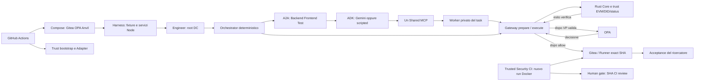

# Delegation — audit tecnico della repository corrente

**Commit analizzato:** `db33f76efa58900ddb869cef5fbe99c5a92bc9c7` (main dopo PR #14).  
**Riferimento Gemini separato:** run `38761963415`, commit `02c3395b9111a63ccc9f441ea2c91c81865d6673`, 15 ottobre 2026.  
**Modalità di consegna:** sola analisi; nessuna correzione applicata.

## A — Sintesi esecutiva

La PR #14 ha eliminato il doppio avvio Gitea nel percorso principale. Restano problemi di proprietà delle risorse, bootstrap e configurazione. I tre punti da affrontare per primi sono il teardown che può rimuovere risorse rifiutate dal preflight, l'avvio Adapter che muta il DID prima di completare le precondizioni e il grafo del binario Adapter non congelato dal lock radice. Non sono prove di una violazione avvenuta nella run riuscita: dipendono da error path o condizioni diverse dalla chain/VM fresca.

Le verifiche gratuite locali hanno completato **442 test unici con esito PASS**. Non è stata eseguita una nuova prova Docker E2E completa, una nuova CI remota o una nuova inferenza Gemini/OpenAI. Il risultato pagato del 15 ottobre rimane attribuito a 02c, mentre il successivo db33 contiene un refactoring del lifecycle. L'audit non trasferisce quella prova al nuovo codice.

Il rapporto distingue **19 rilievi accertati** di gravità diversa da **14 candidati o decisioni aperte**. Gli ID AUD-001…004 seguono l'handoff di ripresa: volume, startup DID, ramo live irraggiungibile e bootstrap copiato. Le altre priorità comprendono il lock Adapter, già segnalato nel precedente audit. «Accertato» può significare prova statica o simulazione controllata: nessun incidente Docker/EVM è dichiarato riprodotto.

## B — Copertura dell’audit


### Fonte primaria e vincoli rispettati

L'ultima richiesta vincolante consente soltanto analisi. Per questa fase è stato usato lo snapshot `/workspace/.audit-final/current`: **tutti i 352 blob tracciati sono stati confrontati con gli oggetti Git di db33f76 e risultano identici**. La storia è stata letta per SHA da `/workspace/delegation`, non assumendo aggiornato un vecchio checkout. La lettura Git remota finale `ls-remote` conferma main a db33f76 al momento del controllo; non congela una branch mobile per il futuro.

I tentativi di lettura GitHub API sono stati bloccati da **HTTP 403 nel CONNECT del proxy**. Non è stata ottenuta una conferma corrente dei metadati della run o dei check remoti. Run/SHA e successo Gemini sono pertanto riferiti alle informazioni dell'utente e alle evidenze versionate, coerenti con la storia locale; il controllo Git di main non verifica i metadati Actions. La riuscita delle regressioni gratuite PR #14 è riferita dall'utente, distinta dai test locali qui eseguiti.

Nella fase corrente nessun file tracciato, baseline IAM, workflow, risorsa remota, commit o PR è stato modificato. Un branch locale era stato predisposto prima dell'ultima istruzione, sotto la precedente autorizzazione alle correzioni; è rimasto pulito e inutilizzato. Non viene quindi affermato che nessun branch sia mai stato creato nell'intera conversazione. Questo rapporto e il CSV sono output esterni alla repository. I vecchi audit e CSV non sono stati riscritti.

### Storia recente e validazioni da non sovrapporre

| Passaggio | Revisione | Significato verificato nella storia locale |
|---|---|---|
| PR #10 + #11 | `7e5f4460498f8e34ced413965cc1a63126597c43`, con merge PR #11 `f9ad77a` | Pulizia dei percorsi precedenti e recupero di asserzioni indipendenti; il guardrailcode è `d9a9b5e`, rapporto originale `8ca0ca8`. |
| PR #12 | `02c3395b9111a63ccc9f441ea2c91c81865d6673` | I job rinunciano alla Compose Gitea allora inutilizzata e gli E2E possiedono una sola Gitea ad hoc. È il codice indicato per la run Gemini5 riuscita. |
| PR #13 | `50c098db5880b755db23998ef509613efdbb45f5` | Solo sette Markdown cambiano rispetto a 02c; documentazione del risultato, non una nuova esecuzione generativa. |
| PR #14 | `db33f76efa58900ddb869cef5fbe99c5a92bc9c7` | La scelta di ownership cambia: Actions/Compose avviano e distruggono Gitea, OPA, Anvil; quattro E2E inizializzano soltanto la repository.11 file cambiano rispetto a 50c, incluso il nuovo helper Compose. |

PR #12 e #14 non sono due correzioni da applicare insieme: scelgono deliberatamente proprietari diversi. Non è più corretto proporre di togliere un `docker run` Gitea o uno `stopDocker` dai quattro coordinator principali: nella revisione corrente non ci sono. Restano Gitea ad hoc in diagnostiche standalone, con consumer e lifecycle propri; non risultano avviate in aggiunta alla Compose nel medesimo job principale.

### Copertura della ricostruzione

Sono stati censiti tutti i 352 file tracciati e ricostruiti i relativi grafi; la lettura mirata ha coperto: manifest e lock, dieci workflow, tutti gli entrypoint npm/CLI, Rust/Adapter/Solidity/DID, risorse target e test,25 Markdown inclusi12 README. Il sottosistema Rust/EVM comprende94 file censiti. Il parser Node ha analizzato196 moduli JS/TS,381 import/export runtime relativi risolti su 817 specifier totali; nessun modulo è stato valutato per costruire il grafo. I 1.015 archi annotati comprendono anche glob, risorse, moduli Rust e riferimenti documentali: non rappresentano 1.015 dipendenze runtime autonome.

Sono stati controllati gli import dinamici dell'acceptance: quattro URL di moduli e `supertest` appartengono alla copia IAM montata nel Runner, non a file mancanti nel framework. Sono state verificate variabili a chiave dinamica per ruolo e subprocessi DID; non sono stati stampati valori di credenziali.42 link Markdown locali hanno tutti destinazioni esistenti. L'assenza di chiamanti interni non viene estesa a consumatori esterni di API esportate, ABI o CLI manuali.

L'inventario precedente di 111 decisioni rimane byteperbyte uguale a 8ca0ca8. Nessuno di quei111 path è cambiato:64 rimossi,28 necessari presenti,11 storici usati presenti,4 da verificare e4 placeholder obsoleti ma conservati. Non conteneva però i quattro workflow mantenuti oggi modificati né il helper Compose. Quindi le vecchie decisioni continuano a essere contestualizzate, ma non erano una prova di unicità del lifecycle attuale. La riga storica sul test GeminiThinking non eseguito è superata dal ripristino nelglob CI; non è un nuovo difetto da correggere due volte.

### Flusso reale e proprietà delle risorse



| Risorsa / passaggio | Creatore e consumer effettivi | Durata e confine da conservare |
|---|---|---|
| Compose Gitea/OPA/Anvil | Quattro workflow coordinator e percorsi locali espliciti. E2Efree:102-119; Composecommittata. | Un'unica Gitea nel percorso principale. Volume dati distrutto dal job, persistente nel locale salvo richiesta esplicita. |
| Deployment trust | bootstrap-trust→deploy-local distribuisce tre registry; workflow fonda/configura identità; Adapter effettua enrollment/chiavi/materiale. | Trecontratti, non tre servizi extra. Stato nella chain; startup locale ripetuta e startup Adapter richiedono i chiarimenti dei rilievi. |
| Adapter | ProcessoRust HTTP; init prima di servire. Core risolve EVM e DID mediante reader e brevi subprocessi Node. | Nessun secondo servizio DID o Anvil persistente trovato nel finale. Firma/verifica e mapping caller→ruolo restano server-side. |
| Gateway, Runner HTTP, Shared MCP e tre A2A | Factory in-process nel medesimo harness Node. Ogni worker privato è una route del server del proprio agente, non altro processo. | Socket loopback dinamici chiusi in finally. CLI standalone sono alternative supportate, non altre istanze lanciate insieme. |
| Root e figli DC | SoftwareEngineerAuthorityBootstrap emette root; coordinator/permission templates emettono figli e ordinano Backend→Frontend→Test. | Il modello non costruisce permessi né sceglie ordine o merge. Branch/PR sono Gateway diretto dell'Orchestrator, non MCP tool. |
| Routing tool | ADK→MCPToolset→Shared MCP→TaskRouter→worker privato con clientGateway in closure. | JWT lega ruolo/task/JTI e routing; non sostituisce la DC. Evidenza, tokenprovider e chiavi non sono nel prompt. |
| Autorizzazione | prepare deriva risorsa/operazione, VP firma Rust, execute consuma preparazione e verifica DC, poi OPA, poi provider. | Rust verifica autorità crittografica; OPA contesto; Gateway PEP. I controlli non sono copie eliminabili. |
| EsecuzioneRunner | Ogni executor.run scarica l'archivio SHA, crea container UUID, esegue6 fasi più acceptance readonly. | Nessun comando shell scelto dal modello. La containerizzazione non prova isolamento contro candidato arbitrariamente ostile. |
| CI fiduciaria | **Stesso oggettoexecutor e stesso processo trusted** nell'harness, nuovo .run e nuovo container/materializzazione; attore/token CI separati. | Non è un secondo processo o un verificatore implementato indipendentemente. La ripetizione pulita e l'identità attestante separate rimangono necessarie. |
| Gate umano | Readiness legge review/CI/protezioni allo SHA; mergeCLI privilegiato distinto con intento umano e identità separata. | La run senza review deve restare PR aperta. La fixture sintetica gratuita non vale come vera approvazione. |
| Teardown | Script chiudono socket/log; Actions fa Compose down --volumes. | Ownership delle risorse rifiutate e cleanup dei container Runner sono due difetti distinti, non il vecchio doppio Gitea. |

Nel free E2E completo sono previste tre esecuzioni Docker sequenziali: candidato positivo, baseline con progetto PASS/acceptance FAIL, candidato sotto Trusted CI. Nel live sono due: candidato e CI. Non si deve eliminare la baseline negativa, né scambiare un fallimento browser/npm per acceptance negativa riuscita.

## C — Problemi accertati


«Accertato» distingue tre livelli: ordine/consumer statici leggibili, comportamento locale riprodotto con doppi controllati e incidente operativo realmente osservato. Non viene dichiarato un exploit o incidente nella run storica. Le condizioni e la forza delle prove sono esplicite; una conseguenza possibile non diventa un incidente avvenuto perché il codice la permette.

| ID | File/componente | Problema reale | Evidenza | Conseguenza | Intervento proposto | Gravità / priorità |
|---|---|---|---|---|---|---|
| AUD-001 | Quattro workflow coordinator e Compose | Il preflight rifiuta un volume preesistente, ma il teardown incondizionato può cancellarlo anche quando quel job non ha eseguito up. | Free .github/workflows/shared-mcp-real-positive-e2e.yml:105-107,189-192; production:107-109,180-183; disposable:112-114,187-190; paid:120-122,206-209. Nome comune delegation-poc-gitea-data e if:always(). validation/ownership-preflight-simulation.json registra il rifiuto e il successivo down --volumes. Analisi upstream Compose 2.40.3 down.go:147-156,275-297: volume non-external rimosso per nome senza check delle label. Moby 28.4.0 store.go:792-811 rifiuta reference container residue. Versioni locali, runner remoto non verificato. | Possibile perdita di dati se il volume preesistente è inutilizzato o viene liberato dalla rimozione dei container dello stesso progetto. Un container estraneo ancora collegato, anche fermato, ne impedisce la rimozione. Servono configurazione valida, daemon/driver operativi. Non osservata alcuna cancellazione. | Associare il cleanup alla proprietà acquisita da questo job, gestendo anche startup parziale; in alternativa isolare progetto/volume per esecuzione. Non trasformare un rifiuto di risorse preesistenti in autorizzazione a rimuoverle. | Alta |
| AUD-002 | services/delegation-adapter/src/http.rs, crypto.rs, evm_profile.rs; src/delegation/issuance/delegation_issuer.rs; src/delegation/trust/material/did_ethr_verification_key_provider.rs; blockchain/did-client/publish-ed25519.mjs | La nuova chiave DID viene pubblicata prima del controllo che può rifiutare un accumulatore già ancorato incompatibile. | crypto.rs:204-219 rigenera issuer e chiavi; evm_profile.rs:426-444 effettua enrollment/pubblicazione DID prima di:446-473 che legge/rifiuta anchor; blockchain/did-client/publish-ed25519.mjs:51-57 invia e attende la transazione. Resolver fresco richiede una sola assertion key a did_ethr_verification_key_provider.rs:168-177. http.rs:33-40 effettua il bind prima di CryptoRuntime::from_config: un errore di bind impedisce di raggiungere il bootstrap mutante. | Riavvio con stesse identità sulla stessa chain può fallire dopo aver mutato il DID usato dal processo precedente. L ordine di scrittura è certo; ambiguità del DID e impatto sul servizio esistente non sono stati riprodotti. Non contraddice il successo su chain fresca. Il percorso richiede bind riuscito, profilo EVM e pubblicazione DID autorizzata; una porta già occupata fa fallire prima di queste scritture. | Preflight completo non mutante prima di enrollment/chiavi/commitment, oppure separazione esplicita fra bootstrap e startup. Non risolvere il conflitto pubblicando automaticamente nuove versioni o rotazioni. | Alta |
| AUD-003 | poc/packages/agent-runtime/scripts/a2a-production-coordinator-mcp-gemini-live.mjs | Il live conserva import, variabili e ramo della fixture di review/merge sintetico non raggiungibile, copiato dalla variante gratuita. | :139-142 rifiuta DISPOSABLE_SIMULATED_MERGE_TEST=1 e imposta simulatedPositiveMerge=false; import TrustedGiteaMergeExecutor:47 inutilizzato; mergeName/mergePassword:254,258; ramo account:263; blocco review-token/merge-token:377-413; positiveMergeFixture:426 senza consumer. | Il file contiene operazioni privilegiate impossibili nel suo contratto attuale e genera dati casuali superflui. Nessun percorso corrente per effettuare quel merge è stato trovato. | Dopo una decisione esplicita rimuovere solo import/variabili/ramo/output morti; conservare rifiuto esplicito, reviewer del gate negativo e fixture positiva realmente usata dal free. Non modificare il workflow manuale durante questo audit. | Media |
| AUD-004 | bootstrapGitea nei quattro script coordinator | Dopo l unificazione dello startup resta provisioning applicativo sostanziale copiato, con una copia che contiene già un ramo morto. | Free a2a-production-coordinator-mcp-isolated-real-positive.mjs:224-417 e live a2a-production-coordinator-mcp-gemini-live.mjs:235-428:194/194 righe identiche. PR-open:163-297 condivide116/135 righe e failing-smoke:161-226 condivide50/66. Le due varianti complete duplicano anche seedPinnedMain. | Scope PAT, protezioni e attori devono essere corretti in più posti; rischio concreto di divergenza. Non significa doppio bootstrap nello stesso run: sono scenari alternativi. | Valutare un helper limitato al contratto comune completo free/live, mantenendo esplicite fixture minime, modelli, assert negativi e modalità sintetica. Non introdurre un framework parametrico per uniformare tutti gli esperimenti. | Media |
| AUD-005 | services/delegation-adapter/Cargo.toml e comandi CI | Il package Adapter separato non ha un lock tracciato e non è congelato dal Cargo.lock root. | Root Cargo.toml non è un workspace; Adapter Cargo.toml:8 dipende via path dalla root; nessun services/delegation-adapter/Cargo.lock tracciato; test/build del package separato senza --locked nei workflow. Già riconosciuto in docs/REPRODUCIBILITY.md:59. | Il contratto corrente copre quattro lock ma non l intero grafo del servizio finale. I 12 test Adapter di questa sessione usano un harness esterno congelato: non colmano il difetto nel repository. | Valutare lock Adapter dedicato o workspace, con build/test --locked e aggiornamento deliberato del solo contratto corrente. Non riscrivere manifest o hash storici. | Alta |
| AUD-006 | poc/scripts/phase1-up.sh; bootstrap-trust.sh; blockchain/scripts/deploy-local.sh | Il riavvio locale richiama sempre il deployment trust senza caricare il trust.env già prodotto. | phase1-up.sh:44-48 chiama bootstrap ogni volta; bootstrap-trust.sh:16 chiama deploy e:45-54 riscrive trust.env; deploy-local.sh:54-78 riusa solo gli address già esportati nella shell con bytecode presente. Il wrapper non carica prima trust.env. | Da una nuova shell, sullo stesso Anvil, infra:up può distribuire tre registry ulteriori e cambiare i riferimenti runtime mentre un Adapter già avviato continua a usare i vecchi. È una ridondanza nel percorso locale, non il doppio Gitea del job già corretto. | Distinguere riuso di deployment verificato da fresh deployment; validare chain, bytecode, associazioni e governance prima di riusare. Non fidarsi di address di una chain precedente. | Media |
| AUD-007 | services/delegation-adapter/src/{crypto.rs,evm_profile.rs} | Inizializza e pubblica anche gli accumulatori dei tre ruoli specializzati che non emettono deleghe. | crypto.rs:204-219 crea cinque DelegationIssuer; evm_profile.rs:434-484 pubblica cinque commitment. issue_root:302-311 consente Engineer e issue_child:351-362 Orchestrator; la VP concreta usa identità/chiave firma in delegation_issuer.rs:366-390. | Tre setup crittografici e pubblicazioni on-chain senza consumer nel contratto applicativo supportato, con stato/versioni da mantenere. Le cinque chiavi DID rimangono necessarie. | Valutare distinzione minima fra signer e issuer o init del materiale solo per i due emittenti. Non rimuovere DID, lifecycle, firme o capability dei cinque ruoli. | Media |
| AUD-008 | services/delegation-adapter/src/evm_profile.rs; src/delegation/local/in_memory_status_list_store.rs | Due implementazioni della stessa responsabilità di storage off-chain. | IssuerAwareStatusProvider in evm_profile.rs:109-141 e InMemoryStatusListStore in Core:12-48 usano la medesima chiave (issuer,url) e output document/commitment_bytes. | Manutenzione duplicata su isolamento tra issuer e binding documento/byte. Non sono due verifiche di sicurezza indipendenti. | Valutare riuso dello store Core nell Adapter, conservando wrapper JWT, anchor, scoping e diagnostica prevista. | Media |
| AUD-009 | poc/apps/test-runner-controller/src/isolated-executor.ts | Il cleanup non controlla l esito rm e non copre una create riuscita nel daemon ma ambigua/fallita nella risposta CLI. | :269-277 imposta containerCreated solo dopo risposta create riuscita;:415-421 ignora eccezioni, exit_code e timed_out di docker rm-f;:119-126 restituisce quei dati per gli altri comandi. I test correnti verificano la chiamata rm, non il suo esito. | In error path può restare un container, anche sleep infinity; il risultato già predisposto può essere PASS senza segnalare cleanup fallito. Compose down non possiede i container Runner standalone. Nessun leak reale osservato in questa sessione. | Registrare intento e nome univoco prima della creazione, tentare cleanup anche dopo risposta ambigua e controllarne risultato. Definire se sia errore infrastrutturale separato o invalidi l attestazione. | Media |
| AUD-010 | poc/apps/test-runner-controller/src/{config.ts,isolated-executor.ts,http.ts}; poc/apps/gateway/src/{config.ts,runner-client.ts} | Il budget cumulativo consentito dal Runner supera il timeout totale del chiamante e l abort HTTP non cancella il lavoro Docker. | Runner config.ts:61-63:600000ms per fase; isolated-executor.ts:49-82,362 prevede sei fasi più acceptance. Gateway config.ts:95-97 e runner-client.ts:108,123:900000ms totali. Nel free300000ms/fase:438 contro900000ms totali:472; http.ts:88 attende executor senza segnale di disconnessione. | Sequenze ammesse dal server possono perdere il chiamante prima del risultato e continuare a consumare risorse. Incoerenza statica dei contratti, non timeout osservato nella run storica. | Scegliere budget complessivo e responsabilità della cancellazione; distinguere CI diretta e richiesta Gateway se intenzionalmente diversi. Non aumentare indiscriminatamente limiti o timeout del modello. | Media |
| AUD-011 | poc/mcp-shared/package.json e test/*.test.ts | I test MCP importano express senza dichiararlo direttamente nel manifest standalone. | poc/mcp-shared/test/{mcp-worker-bridge,mcp-run-tests-http,mcp-write-http,mcp-create-http}.test.ts:5 e scripts/real-read-smoke.mjs:12 importano express; package.json:14-17 dichiara solo SDK e zod. Nella risoluzione standalone Express 5.3.0 arriva transitivamente dal MCP SDK; nel root è dichiarato 5.1.0. | La suite dipende da hoisting/layout di una dipendenza transitiva: un cambiamento di packaging può rompere import o cambiare il server testato. Non giustifica installare una nuova versione a caso. | Rendere esplicita l ownership della dipendenza test oppure eliminare il bisogno mediante fixture già supportata. Coordinare con la scelta packaging, preservando le versioni del contratto. | Media |
| AUD-012 | Cargo.toml e feature efficient | Tre dipendenze dirette e una feature no-op sono residui privi di uso attivo. | Cargo.toml rand:15,csv:21,x25519-dalek:31,efficient:8; ricerca su codice/esempi/test trova zero usi dei tre crate e nessun cfg efficient. RNG attivo è ark_std::rand. parallel_verification è diversa e realmente coperta da all-features. | Grafo e superficie da studiare più ampi del necessario; il manifest intero rimane essenziale. | Rimuovere solo dichiarazioni obsolete con revisione esplicita di manifest/lock/currentcontract; comunicare eventuale ritiro della feature pubblica anche se no-op. Non cambiare versioni indiscriminatamente. | Media |
| AUD-013 | poc/packages/orchestrator-runtime/src/a2a-workflow.ts e sequential-coordinator.ts | expected_revision è validato nella forma ma un diverso valore valido non influisce su autorità, richiestaA2A o risultato. | a2a-workflow.ts:115 chiama expectedRevision(input.expected_revision), poi non ne usa il valore; sequential-coordinator.ts:214 lo passa. validation/expected-revision-probe.json confronta due hash diversi con risultato/chiamate identici, senza rete. | Contratto inerte che suggerisce un vincolo non imposto da quel wrapper. I controlli SHA reali di workflow/Gateway/Runner/CI/merge rimangono distinti: non è una prova di bypassSHA. | Decidere se il parametro appartenga ancora all API oppure debba avere un significato esplicito. Non aggiungere un uguaglianza indiscriminata fra revisioni iniziali e finali: gli agenti producono nuovi commit legittimi. | Media |
| AUD-014 | poc/infra/docker-compose.yml; phase1-check.sh; check-scaffold.mjs | Una rete agent non utilizzata e due directory vuote rimangono obbligatorie soltanto per controlli testuali/scaffold. | Compose:81-83 definisce agent internal senza servizi associati; composeconfig normalizzato la scarta. phase1-check.sh:93-100 ne impone il testo e:107 stampa boundary=DECLARED. infra/env e infra/gitea contengono solo.gitkeep; unico consumer check-scaffold.mjs:16-17. | Residui senza ruolo operativo mantenuti artificialmente e possibile falsa interpretazione dell isolamento: la rete dichiarata non isola agenti host dal provider. | Rimuovere in modo coordinato sole dichiarazioni/placeholder/requisiti artificiali oppure documentarli come schema futuro non attivo. Non sostituire questi controlli con una falsa promessa di sandbox. | Bassa |
| AUD-015 | poc/.env.example | Il template contiene chiavi senza reader e istruzioni/URL di uno scaffold non corrispondente al deployment attuale. | :10GATEWAY_PORT e:19ANVIL_RPC_URL sono le uniche occorrenze tracciate; reader attivi GATEWAY_BIND_ADDR/RPC_URL. Nessun loader automatico poc/.env. Configurazione reale nasce da init-local-env→poc/infra/.env caricato con source; hostnames delegation-adapter/test-runner-controller non sono servizi Compose. | Un operatore può seguire una ricetta che non configura nulla o usa DNS non disponibili; defaultread-only/OpenAI non rappresentano il percorso canonico, pur essendo compatibilità ancora supportate altrove. | Scegliere destinazione host/standalone del template e riallinearne nomi, URL e caricamento, oppure ritirarlo dopo verifica degli usi manuali. Non aggiungere servizi per giustificare il file. | Media |
| AUD-016 | README di Gateway/Runner/MCP/blockchain/Adapter e commento A2A | Riferimenti finali/unici superati, un tipo Rust inesistente e descrizioni dei profili troppo generali possono indirizzare il lettore verso un architettura/configurazione diversa. | GatewayREADME:22 chiama final la run del 13; RunnerREADME:30 the one verified run del 13; MCPREADME:34 cita solo13. BlockchainREADME:37 cita BitstringStatusListResolver anziché il parser attuale. GatewayREADME:31 omette defaultmock; RunnerREADME:16 non distingue acceptance configurabile dal canonico=true; A2Amain:93 parla di tuttiworkflow su FunctionTools. Helper GeminiThinking:56-75 e titoli test:65-99 descrivono ancora oggetto esatto/Phase10B; la proiezione live:69-74 omette invece intenzionalmente sampling deprecato. | Drift operativo/documentale circoscritto. Le evidenze13e15 rimangono valide e distinte; i documenti attuali di indice/ADR e infraPR14 sono in gran parte già corretti. | Correggere riferimenti di componenti e nome simbolo, rimandare al checkpoint come fonte latest e distinguere profili standalone da canonico. Per Adapter distinguere memorydefault da startupEVM. Non riscrivere le evidenze originali per farle apparire attuali. Aggiornare soltanto commento storico e titoli del helper se necessario; non aggiungere temperature al payload live. | Bassa |
| AUD-017 | blockchain/scripts/run-pre-gateway-local.sh e deploy-local.sh | PortaRPC e chiavegovernance accettate dal launcher non sono applicate coerentemente prima di avvio/deployment. | run-pre-gateway-local.sh:11 sonda RPC_URL, ma Anvil:57,64-67 non riceve host/porta;:18 accetta GOVERNANCE_PRIVATE_KEY diversa, mentre GOVERNANCE_ADDRESS è derivata solo:126 dopo il deploy:98. deploy-local.sh:11-13 altrimenti assume governance=deployer. | Con configurazione non default può avviare un nodo sul default e attendere altro endpoint o fallire la governance dopo allocazione. Non riguarda il percorso standard8545/chiave uguale già riuscito. | Limitare il supporto esplicitamente al default oppure validare/derivare host,porta e governance prima di qualunque avvio/scrittura; mantenere lo scopo della sessione manuale persistente. | Media |
| AUD-018 | blockchain/scripts/check-pre-gateway.sh:54-60 | La presenza di node_modules viene usata come prova di installazione valida; altrimenti il helper usa npm install invece del frozen install documentato. | Il helper salta npm se la directory esiste; READMEblockchain:62-65 e CIusano npmci --ignore-scripts --no-audit --no-fund. | Dipendenze stale possono passare il prerequisito o il lock essere risolto/riscritto diversamente dalla CI. Non è stata riprodotta una variazione di lock in questa sessione. | Usare la stessa installazione frozen/noninterattiva del clientDID ed evitare che la sola directory equivalga a verifica. | Bassa |
| AUD-019 | services/delegation-adapter/src/crypto.rs:172,240,260 | Il campo privato _local_trust_store non viene letto e mantiene un Rc aggiuntivo già posseduto dai provider/verifier. | Definizione e due assegnazioni sono le sole occorrenze; verifiermemory possiede clone:236-237; profiloEVM conserva provider:176-179,193-197. | Ownership apparente in più rende meno chiara la durata del materiale. Non c è un secondo store allocato: soltanto un riferimento proprietario ridondante. | Valutare rimozione del solo campo e assegnazioni, preservando store/provider e gli altri proprietari. | Bassa |

### Responsabilità, rischio e prova gratuita richiesta per ogni intervento

La tabella riassume i rilievi; il CSV allegato conserva integralmente prove, occorrenze, conseguenze e proposte. Di seguito sono espliciti responsabilità, rischio e test di ciascun intervento.

**AUD-001 — Quattro workflow coordinator e Compose**

Responsabilità: Preparare e rimuovere esclusivamente le risorse possedute dal job. Prova: **Percorso shell riprodotto con shim Docker non mutante; nessun Docker daemon chiamato**. Rischio: Medio: cambiare nomi/progetto o marker riguarda preflight, startup parziale e compatibilità locale.

Validazione necessaria: Simulazioni non mutanti: volume già esistente, errore inspect, up parziale, avvio normale. Poi Docker free reale con risorsa sentinella preesistente intatta e tutte le risorse proprie rimosse.

**AUD-002 — services/delegation-adapter/src/{crypto.rs,evm_profile.rs}; DID publisher**

Responsabilità: Avviare il servizio e inizializzare identità/materiale su una chain compatibile. Prova: **analisi statica, nessun incidente riprodotto**. Rischio: Medio per preflight, alto per persistenza/separazione del materiale e cambi del modello trust.

Validazione necessaria: Fresh chain PASS; seconda startup sulla medesima chain rifiutata senza cambiare DID/nonce/anchor; identity/chain mismatch prima delle scritture; Core, Adapter, Solidity, Phase11 e Docker E2E gratuito.

**AUD-003 — poc/packages/agent-runtime/scripts/a2a-production-coordinator-mcp-gemini-live.mjs**

Responsabilità: Eseguire solo la prova live con merge vietato. Prova: **analisi statica, nessun incidente riprodotto**. Rischio: Basso sul ramo morto, medio sulla chiarezza della nuova provenienza del live modificato.

Validazione necessaria: Sintassi/import, guardie billing/merge, prova offline che il divieto sia ancora prima del lavoro, regressioni negative. Nessun paid run necessario a dimostrare una costante false; nuova versione non eredita il vecchio PASS.

**AUD-004 — bootstrapGitea nei quattro script coordinator**

Responsabilità: Inizializzare account, token, repository e protezioni della fixture applicativa. Prova: **analisi statica, nessun incidente riprodotto**. Rischio: Medio/alto: provisioning di privilegi, token e protezione branch è sensibile.

Validazione necessaria: Confronto dei contratti di ritorno, ID, scope PAT e regole; test di errori/no-secret-leak; smoke positivo e negativo, merge sintetico solo fixture, negative authority/acceptance e Docker E2E free completo.

**AUD-005 — services/delegation-adapter/Cargo.toml e comandi CI**

Responsabilità: Congelare le dipendenze del binario che applica il contratto Rust. Prova: **analisi statica, nessun incidente riprodotto**. Rischio: Medio: la nuova risoluzione può differire da quella della run pagata e va etichettata come nuova configurazione.

Validazione necessaria: Provenienza della risoluzione, clean build/test --locked per entrambi i package, runtime/lock contract e Docker free; nessun aggiornamento indiscriminato di versioni.

**AUD-006 — poc/scripts/phase1-up.sh; bootstrap-trust.sh; blockchain/scripts/deploy-local.sh**

Responsabilità: Preparare dipendenze locali persistenti e caricare il deployment corretto. Prova: **analisi statica, nessun incidente riprodotto**. Rischio: Medio: riuso troppo permissivo può collegare il servizio a registry sbagliati.

Validazione necessaria: Due startup nella stessa chain con address invariati; restart chain e riuso rifiutato; bytecode mancante, chain ID diverso e Adapter già attivo. Nessuna modifica al baseline IAM remoto.

**AUD-007 — services/delegation-adapter/src/{crypto.rs,evm_profile.rs}**

Responsabilità: Fornire identità firmatarie a cinque ruoli ed emissione DC a due ruoli. Prova: **analisi statica, nessun incidente riprodotto**. Rischio: Medio/alto: inizializzazione crittografica e API ruoli, non cancellazione di semplici righe.

Validazione necessaria: Contare due pubblicazioni di materiale e cinque chiavi DID; root/child/VP per tutti i ruoli, status e non-escalation; Core/Adapter, Phase11 e free E2E.

**AUD-008 — Adapter evm_profile.rs; Core local/in_memory_status_list_store.rs**

Responsabilità: Conservare artefatto status e byte esatti sotto chiave issuer+URL. Prova: **analisi statica, nessun incidente riprodotto**. Rischio: Basso/medio: conservare precisamente byte, errori e separazione issuer.

Validazione necessaria: Issuer/URL differenti, missing artifact, byte JWT immutati, firma invalida, commitment mismatch, revoca/sospensione e Adapter/free E2E.

**AUD-009 — poc/apps/test-runner-controller/src/isolated-executor.ts**

Responsabilità: Rimuovere il container creato per ogni richiesta anche dopo errori. Prova: **analisi statica, nessun incidente riprodotto**. Rischio: Medio: modifica gestione errori e contratto del verdetto, da decidere esplicitamente.

Validazione necessaria: Create ambigua/timeout, rm nonzero/timeout, estrazione fallita e assenza di tutti i nomi propri dopo prove Docker reali fuori dallo stack di altri test.

**AUD-010 — Runner config/executor, Gateway runner-client e HTTP controller**

Responsabilità: Applicare budget e cancellazione coerenti alla medesima operazione. Prova: **analisi statica, nessun incidente riprodotto**. Rischio: Medio/alto: cambia comportamento operativo di richieste lente e classificazione errori.

Validazione necessaria: Tempo virtuale, disconnessione HTTP, abort propagato e container rimosso; CI pending→error dopo interruzione; free Docker completo.

**AUD-011 — poc/mcp-shared/package.json e test/*.test.ts**

Responsabilità: Dichiarare le dipendenze proprie del package e dei suoi test. Prova: **analisi statica, nessun incidente riprodotto**. Rischio: Basso/medio: modifica manifest/lock, possibile scelta di versione da rendere reviewabile.

Validazione necessaria: Install standalone pulito senza root node_modules, risoluzione Express attesa e17test MCP; test root e contract dei lock.

**AUD-012 — Cargo.toml e feature efficient**

Responsabilità: Descrivere solo le dipendenze e feature del Core effettivamente supportate. Prova: **analisi statica, nessun incidente riprodotto**. Rischio: Basso/medio: feature downstream e ricomposizione delle transitive; non prova assenza di ogni consumer esterno.

Validazione necessaria: Core default/all-features, Adapter frozen, clean install e contratto corrente; free E2E se cambia il grafo del binario finale.

**AUD-013 — poc/packages/orchestrator-runtime/src/a2a-workflow.ts e sequential-coordinator.ts**

Responsabilità: Gestire un parametro di revisione che appare parte del contratto RoleRunner. Prova: **Comportamento riprodotto offline con doppi controllati; nessuna rete**. Rischio: Medio di API/semantica; basso per documentare onestamente la situazione.

Validazione necessaria: Preservare probe dei due valori, validazione malformed, emissione figlia e artefatto; test sequenza Backend→Frontend→Test e exactSHA separati. Qualsiasi nuovo vincolo richiede uno scenario preciso.

**AUD-014 — poc/infra/docker-compose.yml; phase1-check.sh; check-scaffold.mjs**

Responsabilità: Descrivere e verificare le risorse realmente usate dallo stack. Prova: **analisi statica, nessun incidente riprodotto**. Rischio: Basso se esclusivamente scaffold; mantenere binding reali, permessi e verifiche trust.

Validazione necessaria: Composeconfig normalizzato, scaffold, checklocale e regressioni gratuite; verificare che freshcheckout conservi solo directory effettivamente richieste.

**AUD-015 — poc/.env.example**

Responsabilità: Fornire una ricetta manuale valida per i launcher supportati. Prova: **analisi statica, nessun incidente riprodotto**. Rischio: Basso per chiavi senza reader; medio per ritiro di un interfaccia manuale con consumer esterni non noti.

Validazione necessaria: Parsing config con env sintetico, startup host senza providerkey, controllo nomi e Composeconfig. Nessuna chiamata modello.

**AUD-016 — README di Gateway/Runner/MCP/blockchain/Adapter e commento A2A**

Responsabilità: Descrivere responsabilità attuali e provenienza sperimentale senza confondere i profili. Prova: **analisi statica, nessun incidente riprodotto**. Rischio: Basso per testo/link; nessuna rimozione automatica di configurazioni o test.

Validazione necessaria: 42 link locali, simboliRust, confronto con config e comandi documentati; mantenere checksum delle evidenze e separazione02c/db33.

**AUD-017 — blockchain/scripts/run-pre-gateway-local.sh e deploy-local.sh**

Responsabilità: Avviare la regressione trust storica conoverride coerenti. Prova: **analisi statica, nessun incidente riprodotto**. Rischio: Basso/medio: compatibilità mintty/nohup e gestione risorse locali; non un refactor del percorso agentico.

Validazione necessaria: Comandi osservati tramite shim; porta libera nondefault e governance diversa in chain isolata; defaultstorico e guard endpoint occupato; teardown dei soli processi propri.

**AUD-018 — blockchain/scripts/check-pre-gateway.sh:54-60**

Responsabilità: Installare la risoluzione DID della regressione trust in modo ripetibile. Prova: **analisi statica, nessun incidente riprodotto**. Rischio: Basso: install frozen può correttamente rifiutare lo stato che prima veniva accettato.

Validazione necessaria: Setupclean, directory incompleta/stale, lockimmutato e regressione trust; sintassi shell. Nessuna inferenza.

**AUD-019 — services/delegation-adapter/src/crypto.rs:172,240,260**

Responsabilità: Conservare lo stato off-chain mediante proprietari effettivamente necessari. Prova: **analisi statica, nessun incidente riprodotto**. Rischio: Basso: campo privato, ma verificare entrambe le costruzioni e le durate.

Validazione necessaria: TestCore/Adapter e avvioEVM; uso dopo uscita dei binding locali. Nessun cambio di API o modello.

### Come leggere i rilievi più delicati

La simulazione precedente ha eseguito soltanto i due blocchi shell del workflow gratuito con un **comando Docker finto**: `volume inspect` simulato positivo, rifiuto con exit 1, poi teardown `always()` che registra `down --volumes`. Non prova una cancellazione: il daemon non è stato chiamato.

Alla ripresa è stata completata l'analisi delle condizioni di rimozione, senza nuovi test sui volumi. Le versioni installate localmente sono **Docker Compose 2.40.3** e **Docker Engine 28.4.0**. Nei sorgenti upstream corrispondenti, `pkg/compose/down.go:147-156` enumera i volumi dichiarati dal modello e salta quelli `external`; `:275-297` usa il nome configurato, non verifica le label del volume e richiede `VolumeRemove(name, true)`. I container selezionati del progetto vengono rimossi prima (`:80-95`). In Moby `volume/service/store.go:792-811`, qualunque reference residua di un container impedisce la rimozione: `force` non supera quel controllo. Compose tratta il conflitto come avviso e può comunque terminare con successo.

Il volume fisso `delegation-poc-gitea-data` è dichiarato **non esterno** nel Compose della repository. La rimozione può quindi riuscire se è già inutilizzato, anche con label estranee, oppure se le sue reference appartengono ai container del progetto `delegation-thesis-poc` che il medesimo `down` riesce a rimuovere. Se rimane collegato un container estraneo, anche fermato, Docker rifiuta la rimozione. Servono inoltre configurazione caricabile, daemon raggiungibile, operazioni autorizzate e driver che completi la richiesta. Non è corretto affermare che venga eliminato qualsiasi volume in uso.

Questa è un'analisi del controllo di flusso e del codice upstream per le **versioni locali**. I job usano `ubuntu-latest` e non fissano la versione Compose; non è stata verificata la versione del runner GitHub della run storica. Non sono stati eseguiti `down`, `rm`, `stop` né una cancellazione di prova. Fonti conservate in `validation/docker-compose-v2.40.3-down.go` e `validation/moby-v28.4.0-volume-store.go`; URL e hash sono in `validation/compose-ownership-source-proof.json`.

L'Adapter su chain già inizializzata rigenera materiale, esegue scritture DID e solo dopo può rifiutare l'anchor; questa sequenza è dimostrata dal codice. Non è stato avviato un secondo Adapter né osservata l'ambiguità di chiavi nel DID Document di prova. Il rimedio non consiste nell'accettare il nuovo materiale o ruotare automaticamente chiavi: cambierebbe fiducia e validità delle credenziali.

expected_revision è una promessa API inerte, non una prova che lo SHA del Runner possa essere scelto arbitrariamente. Il probe cambia due hash formalmente validi e ottiene medesima autorità/richiesta/risultato; input malformati sono ancora rifiutati. I controlli SHA effettivi del workflow, provider, Runner,CI e merge restano al loro posto. Un'eventuale nuova uguaglianza deve distinguere revisione iniziale dal commit prodotto dall'agente.

La duplicazione di storage status riguarda implementazioni della stessa mappa, non l'autenticazioneJWT e il commitment corrente: questi ultimi hanno scopi diversi e vanno mantenuti. Analogamente, i tre accumulatori inutilizzati non significano tre DID superflui. La correzione deve conservare identità e firma di Backend/Frontend/Test.

### Chiusura dei quattro rilievi prioritari dell'handoff

**AUD-001 — Occorrenze e condizioni.** I quattro file sono `.github/workflows/shared-mcp-real-positive-e2e.yml` (preflight 105–107, teardown 189–192), `.github/workflows/shared-mcp-production-coordinator.yml` (107–109, 180–183), `.github/workflows/disposable-simulated-approval-merge.yml` (112–114, 187–190) e `.github/workflows/gemini-paid-shared-mcp-final.yml` (120–122, 206–209). Tutti verificano lo stesso nome di volume, rifiutano il riuso e hanno un teardown `always()`. La simulazione ha riguardato **solo il workflow gratuito**. Le condizioni precise per l'effettiva cancellazione, e il caso in cui Docker la rifiuta, sono descritte sopra; non è stata dimostrata perdita di dati su un daemon reale. Il rischio è condizionale a risorse preesistenti, non un incidente osservato sulla VM effimera della run riuscita.

**AUD-002 — Percorso statico e precondizioni.** `main.rs::run` carica la configurazione; `http.rs::run:33-40` tenta prima `Server::http` e poi `CryptoRuntime::from_config`. Con `trust_profile=evm`, `crypto.rs::new_evm` crea nuovi issuer tramite `initialize_issuers:204-219`; `DelegationIssuer::new` usa entropia fresca e genera materiale accumulatore e chiavi Ed25519 (`src/delegation/issuance/delegation_issuer.rs:44-68`). `EvmAdapterProfile::initialize` arriva a `bootstrap_identities`: dopo l'enrollment, `evm_profile.rs:439-444` chiama `publish_did_ed25519`, che invoca `blockchain/did-client/publish-ed25519.mjs`. Lo script controlla chain/owner, pubblica l'attributo e attende la transazione (`:51-57`). Solo dopo, `evm_profile.rs:446-473` legge versione/anchor e può rifiutare l'hash incompatibile.

Perché il caso si realizzi servono: bind disponibile; configurazione EVM valida con gli stessi registry e identità su una chain già usata; chiave Ethereum ancora autorizzata e fondi per la pubblicazione; transazione DID riuscita; materiale nuovo incompatibile con l'anchor esistente. Un errore di bind, configurazione, owner o pubblicazione può fermare prima il percorso. Se la prima istanza occupa ancora la stessa porta, la seconda fallisce al bind: per affiancarla occorrerebbe una porta diversa; dopo un arresto il bind può invece riuscire normalmente.

L'errore successivo non annulla una transazione già confermata. La nuova assertion key può coesistere con la precedente ancora valida; il resolver corrente richiede esattamente una chiave Ed25519 (`did_ethr_verification_key_provider.rs:143-177`) e può quindi rifiutare risoluzioni successive. È un rischio di coerenza/disponibilità del trust, non un bypass dimostrato. **Nessun riavvio, transazione o DID Document a due chiavi è stato riprodotto in questa sessione.** La correzione minima da valutare è un preflight completo prima delle scritture; persistenza o rotazione automatica sarebbero cambiamenti distinti e più rischiosi.

**AUD-003 — Prova di irraggiungibilità.** Nel file `poc/packages/agent-runtime/scripts/a2a-production-coordinator-mcp-gemini-live.mjs`, la guardia a 139–141 rifiuta `DISPOSABLE_SIMULATED_MERGE_TEST=1` e a 142 assegna `const simulatedPositiveMerge=false`, mai riassegnata. Restano l'import `TrustedGiteaMergeExecutor:47`, `mergeName:254`, `mergePassword:258`, l'espansione condizionale dell'account `:263`, e `if(simulatedPositiveMerge)` a 377–413 con creazione di token review/merge, collaboratori e `positiveMergeFixture`. Quest'ultimo valore viene restituito a 426 ma non ha un consumer live. Nessun valore dell'ambiente rende vera quella costante: il valore `1` provoca prima un errore; gli altri non cambiano `false`.

Una futura rimozione deve limitarsi a questi elementi: il file live resta necessario. Devono rimanere il divieto esplicito, il reviewer sintetico usato come identità attesa dal gate negativo, le verifiche senza review e il trusted merge writer nei suoi consumer reali. La variante `a2a-production-coordinator-mcp-isolated-real-positive.mjs` e il workflow `disposable-simulated-approval-merge.yml` esercitano invece davvero il ramo positivo gratuito: non vanno eliminati né modificati per deduzione dal ramo morto del live. Sintassi/import, guardie negative e prova gratuita del merge sintetico sono verifiche sufficienti dell'eliminazione locale del ramo impossibile; non costituiscono una nuova esecuzione generativa.

**AUD-004 — Parte identica e differenze intenzionali.** `bootstrapGitea` contiene 194 righe identiche tra `a2a-production-coordinator-mcp-isolated-real-positive.mjs:224-417` e `a2a-production-coordinator-mcp-gemini-live.mjs:235-428`. Le responsabilità comuni sono account, scope PAT, organizzazione/repository, import della baseline pinned, attori di CI/readiness e protezioni. Anche clone/push/verifica della baseline sono paralleli (`:122-155` free, `:150-183` live). Le fixture degli altri due coordinator iniziano a `isolated-pr-open-smoke.mjs:163` e `isolated-smoke.mjs:161` e preparano scenari minimali diversi.

Il testo identico non implica che l'intero script sia intercambiabile: il free può abilitare la review sintetica, il live la vieta; modelli, budgeting, evidenze generative e oracoli positivi/negativi sono differenti. Le fixture con Runner stub non hanno lo stesso contratto della baseline completa. Non viene eseguito due volte `bootstrapGitea` nella medesima run: il problema è manutentivo, con più copie della preparazione privilegiata e un residuo già divergente.

Un helper ristretto alla preparazione applicativa realmente comune può ridurre il rischio di correggere scope/token/protezioni in una sola copia. Conviene estrarlo solo dopo aver confrontato input, output e differenze di privilegio; non serve un framework generico di provisioning né unificare i test. Se il costo di esplicitare i profili supera il beneficio, mantenere le varianti con test comuni degli invarianti è un'alternativa valida. Nessuna estrazione è stata applicata.

## D — Problemi potenziali


Questi casi hanno osservazioni verificabili ma non una prova sufficiente per autorizzare una cancellazione, dichiarare un incidente o imporre una nuova architettura. Condividono la stessa serieID delCSV e sono marcati **D**. Non vengono sommati ai problemi accertati come se fossero equivalenti.

| ID | Componente | Osservazione ed evidenza | Cosa manca / come verificare | Rischio / priorità |
|---|---|---|---|---|
| AUD-020 | orchestrator-runtime/src/adk-orchestrator.ts, test, export e dipendenze | Residuo del vecchio percorsoPhase10B senza caller operativo attuale, ma con API esportata e sei test propri. Il vecchio caller phase10b-positive-e2e è rimosso; il finale istanzia AccountSuspensionSequentialCoordinator direttamente. Definizione, test ed exportindex:9 restano. | Decidere ritiro coeso modulo+testfacciata+export+dipendenze divenute superflue, oppure dichiararlo estensione supportata. Non cancellare coordinator/authority/gate. Verifica: Mappa consumer esterni e decisionecontratto; suiteOrchestrator/ADK, imports,lock,currentcontract,freeE2E. | Medio di API: test ed export non sono consumer finali, ma l uso esterno non è noto. Priorità: Media |
| AUD-021 | A2Astandalone, OpenAIAdkModel e OpenAIResponsesClient | CompatibilitàOpenAI estranea al finaleGemini, ma ancora selezionabile come default del launcherADK. apps/a2a-agent/src/main.ts:72-83 seleziona OpenAI; classi esportate/testate; ResponsesClient nonADK ha soltanto test/barrel. Contratti e customcontroller restano usati da Phase11. | Decidere scopeGemini-only e migrare prima default/export/caller; non eliminare tutto llm-client/controller né togliere direttamente il package. Verifica: CLIbootstrap senza chiavi, contratti sintetici, Phase11 e altre suite; cleanlock/currentcontract; nessuna chiamataOpenAI. | Medio/alto di compatibilità e lock; nessuna prova di inutilità del runtimecustom intero. Priorità: Media |
| AUD-022 | agent-runtime/src/artifact-builder.ts:8-22; orchestrator-runtime/src/permission-templates.ts:238-246 | Due simboli con sola definizione e nessun consumer interno, ancora esposti via barrel. Ricerca dei simboli su tutti i file tracciati restituisce solo definizioni; artifactfinale usa operazioniGateway confermate e permissiontemplates usano helper interni distinti. | Dopo decisione su consumer esterni rimuovere solo due funzioni e typeimport divenuto inutile, non moduli interi o deterministartifact. Verifica: Imports, artifact/permissiontests, Node e scope11file; verificare eventuali consumer fuori repository. | Basso internamente; estensioni esterne non enumerate anche se packageprivate. Priorità: Bassa |
| AUD-023 | Core Rust: resolver/getter/costruttori pubblici senza caller finale | APIstatus semplice, rimozione accumulatore, costruttori senza status e DIDowner getter hanno solo test o nessun caller nel repository. ProviderStatusListResolver solo propriotest/re-export; AccumulatorManager::remove_element/remove_elements senza caller; Credential::from_string e costruttori legacy; EvmRegistryReader::identity_owner:125-131 serve il relativo getter/ABI. | Decidere se il Core rimanga generico o soltantoPoC; deprecare/rimuovere per gruppi limitati dopo inventario downstream. Conservare statusEVM, ABIvendor, parser e test dei confini. Verifica: Downstream/APIcheck, Core/Adapter/esempio live, teststatus/commitment; migrazione di firme costruttore se necessaria. | Medio di API/semantica; non trasformare una pulizia in revisione crittografica. Priorità: Bassa/Media |
| AUD-024 | compose-gitea.mjs:28-33 | Il preflight trova bindingloopback e volumeattesi con some, senza escludere binding/mountaggi aggiuntivi. Composecommittato:20-25 è corretto; il helper verifica presenza e non esclusività. | Chiarire se sia soloidentitypreflight o intero isolamento; nel secondo caso aggiungere negativi su tutti binding/mount. Non dichiarare un vulnerabilità corrente del Compose. Verifica: Inspect sintetico con binding0.0.0.0/mountaggi extra, composeconfig reale; nessuna modifica dell infrastruttura in audit. | Basso/medio per controlli più stretti; possibili configurazioni locali intenzionali da considerare. Priorità: Media se si amplia il contratto |
| AUD-025 | merge-readiness.ts; trusted-merge.ts; protezioniGitea | Il contestoCI non è regola server-side obbligatoria; le riletture non rendono atomico un cambio status sul medesimoSHA prima del POST. Bootstrapfree:281-286 non richiede context; verifier:207-219 legge status; trustedmerge:160-164 ripete. Limite già dichiarato PR10audit:120. | Validare semanticaGitea fissata e policyserver-side prima di rafforzare. Conservare riletture, reviewautentica e head_commit_id. Verifica: Testconcorrenza controllati e branchprotection della versione fissata; verifica conattoriservizio separati in fixture. | Alto: policyGitea/versione/review reale. Non simulare una review umana autentica. Priorità: Alta prima di esposizione produttiva; separata dalla pulizia |
| AUD-026 | Runner e researcheracceptance nello stesso container | Read-only protegge i test del ricercatore ma non separa toolchain/dipendenze della copia candidata. isolated-executor.ts:55,82 e mount:262; acceptanceimporta moduliapp. Già descritto nelPR10audit:121. | Decidere modello di minaccia prima di introdurre nuovo isolamento. Non fondere acceptance nei testmodificabili dall agente. Verifica: Prove avverse controllate e ambienti indipendenti se richiesti; mantenere positivi/negativi attuali. | Alto se cambia runtime/testisolation e contratto sperimentale. Priorità: Separata dalla pulizia; alta per produzione |
| AUD-027 | isolated-executor.ts:180,202,209-216 | Limitebyte ricontrollato dopo arrayBuffer e fetch senza timeout specifico possono consumare risorse su provideranomalo. Content-length controllato se presente, poi allocazione completa e check; assenza/inesattezzaheader non pone limitepreventivo. | Prima riprodurre con stream/providercontrollato e dimensionare il requisito; valutare streamlimit e timeout. Non cancellare checkattuale. Verifica: Headeromesso/falso, chunkoltrelimite, providerlento e abort; nessun downloadostile reale. | Medio: gestione stream/abort/cleanup e limiti compatibili conbaseline. Priorità: Media |
| AUD-028 | agent-runtime taskcontext store ed executor | Il registryMCP termina client/token, ma delete del contextstore A2A non viene richiamato nel finally che elimina solo running. dependencies.md descrive consumerstore/executor; processo canonico effimero, CLIstandalone potenzialmente persistente. | Chiarire retention/getTask/history e lifecycle prima di cancellare metodi o contesti; non rimuovere delete perché privo di caller. Verifica: Piùtask nello stesso processo, completamento/cancel/errore, getTask senza evidenza e misura store; wrapperprivacy intatti. | Medio: può rompere recuperotask e contrattoA2A. Priorità: Media per servizio duraturo |
| AUD-029 | Workflow su vecchia featbranch; smokealias manuali | Alcuni workflow selezionano ancora la vecchia featurebranch o solo dispatch; Phase11 non è PRgate. isolated-positive-security-ci.yml:9 e disposable-simulated-approval-merge.yml:13 pushfeat/shared-mcp-spike+manual; phase11pushmain+manual. Failingcoordinator ha npmCLI ma nonworkflowautomatico. | Scegliere quali check sono gatePR, quali manuali, quali ritirati, con matrice delle assertion esclusive. Non riesumare tutti vecchiworkflow. Verifica: Analisi trigger e test di selezione; free smoke mirati quando previsti dalla decisione. | Medio di contrattoCI/costi gratuiti; non eseguirepaid per verificareselezione. Priorità: Bassa/Media |
| AUD-030 | Adapter/Runner/MCP standalone e processi di job | Lifecycle normale è gestito, ma non è stata provata la chiusura completa durante SIGTERM/errore di cleanup. Adaptercargo run inbackground non sempre haPIDcleanup nei4coordinatorworkflow; Runner/MCPstandalone senza hookapplicativi. VMhosted distrugge ambiente; i quattroE2E non hanno più stopDockerGitea. | Riprodurre interrupt a metàrun e decidere contratto di shutdown prima di aggiungere kill/cleanup globali. Verifica: SIGTERMdurante.run, child/containerpendenti, cleanup fallito e assenza orfani propri in ambiente isolato. | Medio: segnali e risorse condivise, non terminare processi altrui. Priorità: Media per localerobusto |
| AUD-031 | poc/scripts/phase4a-policy-test.sh:7-15 | opa fmt senza fail/diff e opa test rileggono la stessa sintassi in due containersequenziali. Il primocomando scrive formattazione stdout scartato, non ne asserisce lo stile; il secondo compila policy/test. Nessun secondo serverOPA persistente. | Facoltativamente mantenere solo opatest se il requisito è validità; un nuovo vincoloformat va scelto esplicitamente, non come refactor estetico automatico. Verifica: Policyvalida e sintassierrata in copiaesterna, entrambi rilevati appropriatamente da opatest. | Basso se vengono preservati errori/exit del checkreale. Priorità: Bassa, facoltativa |
| AUD-032 | poc/package.json; poc/mcp-shared/package.json e due install npm | Package standalone con lock/install separati: la sovrapposizione di92coppie è un costo di layout da valutare, non una duplicazione inutile già dimostrata. Workspace root apps/*,packages/* esclude mcp-shared. Lock root281record, MCP96; normalizzando nome/versione tutte92coppie uniche MCP sono già nel root. Baseline installa entrambi; MCP ha CLI e README propri. | Decidere se il package debba restare standalone o entrare nel workspace. Non rimuovere npmci o lock perché le coppie sono sovrapposte: risoluzione peer/hoisting e modalità supportate vanno preservate. Verifica: Clean install frozen delle modalità scelte, identità versioni risolte, suite17MCP piùADK/A2A e free E2E, corrente lock contract aggiornato deliberatamente. | Medio: risoluzione peer/hoisting e versioni Express diverse rendono non equivalente la semplice rimozione di un install. Priorità: Media |
| AUD-033 | src/delegation/issuance/{issuer_trait.rs,delegation_issuer.rs} | Il trait offre un default meno specifico della guardia concreta; eventuale uniformazione richiede una decisione sul contratto generico pubblico. issuer_trait.rs:30-45 firma senza la guardia delegatee; override delegation_issuer.rs:373-379 rifiuta holder differente. Il verifier controlla comunque il binding: non è un bypass dimostrato nel flusso finale. | Rendere esplicita/obbligatoria l implementazione oppure centralizzare preservando la guardia. Non eliminare l override sicuro per ottenere DRY. Verifica: VP con holder errato, override corrente, implementazione fittizia che eserciti il contratto trait; Core e Adapter. | Medio: trait pubblico e contratto crittografico, consumer esterni non enumerati. Priorità: Bassa/Media |

I metodi Rust pubblici con pochi caller non sono equivalenti a campi privati inutilizzati. Non conosciamo tutti i downstream, ABI o deployment fuori repository. Il wrapper ADK dell'Orchestrator è realmente fuori dal percorso finale, ma eliminare export/test/dipendenze richiede prima decidere se resti un'estensione supportata. Lo stesso vale per OpenAI standalone: esiste un caller e un default reale, mentre il canonico Gemini non lo usa.

Restano hardening fuori dal piano di pulizia: lunghezze witness malformate potrebbero raggiungere Vec::remove nel Core; encoding metadata con separatore& è ambiguo nel generico; VerifiedDelegation è costruibile/deserializzabile pubblicamente pur essendo un risultato verificato. Non è stata dimostrata una via di bypass nelGateway finale e una modifica di witness/encoding/API non va nascosta in una pulizia. Eventuale attività richiede threat model e prove dedicate.

## E — Residui storici e dipendenze superflue

La pulizia precedente ha già eliminato i 64 file riportati nell'inventario storico (62 PR #10 e due PR #11). Non è stato individuato un altro blocco comparabile di interi file operativi certamente cancellabili senza una decisione sul supporto. Restano però residui specifici dimostrati e candidati separati: non va dedotto che ogni file rimasto sia indispensabile.

| Residuo / candidato | Prova e classificazione | Ambito di un eventuale intervento |
|---|---|---|
| Fixture di merge sintetico nel live — AUD-003 | Costante false e ramo senza consumer; accertato. | Eliminare soltanto import, variabili e blocchi morti; conservare file live e fixture gratuita attiva. |
| `rand`, `csv`, `x25519-dalek`, feature `efficient` — AUD-012 | Nessun uso diretto dei tre crate in sorgenti/esempi/test e nessun `cfg efficient`; RNG effettivo da `ark_std::rand`. | Dichiarazioni residue; eventuale lock/current-contract va aggiornato deliberatamente. Non tutti i crate transitive spariranno necessariamente; compatibilità esterna della feature da valutare. |
| `_local_trust_store` — AUD-019 | Campo privato con sole due inizializzazioni; provider/verifier possiedono già gli `Rc` necessari. | Solo campo/assegnazioni, non lo store. Beneficio piccolo, non prioritario prima della tesi. |
| `poc/infra/env/.gitkeep`, `poc/infra/gitea/.gitkeep`, rete `agent` — AUD-014 | Directory vuote richieste solo dallo scaffold; rete non collegata e scartata da Compose normalizzato. | Eventuale rimozione coordinata dei requisiti artificiali; non aggiungere una nuova rete/astrazione per giustificarli. |
| `poc/.env.example` — AUD-015 | Due chiavi senza reader, URL e istruzioni non allineati ai launcher attuali. | Riallineare o ritirare il template dopo aver scelto il percorso supportato; non eliminare `infra/.env` o il generatore attivo. |
| Facciata ADK dell'Orchestrator — AUD-020 | Vecchio caller operativo Phase10B eliminato; rimangono sei test e barrel pubblico. | Candidato di perimetro, non cancellazione già dimostrata sicura per ogni consumer. L'Orchestrator deterministico corrente resta necessario. |
| Compatibilità OpenAI — AUD-021 | `OpenAIAdkModel` è default selezionabile del CLI ADK; il client Responses non ADK ha solo test/export interni. | Valutare separatamente il client storico; non rimuovere l'intero provider o i tipi ModelClient, ancora collegati a runtime/test. |
| `buildLlmArtifactPayload`, `repositoryPermissionUris` — AUD-022 | Soltanto definizioni interne, con export pubblici superstiti. | Assenza di caller interni accertata; ritiro dell'API resta una decisione di compatibilità. |
| API Core senza caller finale e alias di smoke — AUD-023 / AUD-029 | Libreria pubblica, test e CLI manuali sono consumer/contratti possibili; i downstream non sono stati censiti fuori repository. | Matrice delle responsabilità prima di ritirare moduli, feature o workflow. Nessuna rimozione basata solo su grep o nomi storici. |

Le versioni A2A annidate, i peer MCP dell'ADK, i client DID richiamati da Rust e i materiali scientifici non sono dipendenze inutili dimostrate. I commenti su Phase10B o su configurazioni superate rientrano nel drift documentale AUD-016, non rendono obsolete le fixture Gemini importate offline.

## F — Componenti da conservare


| Componente apparentemente ridondante | Consumer o proprietà effettiva | Perché la rimozione sarebbe sbagliata |
|---|---|---|
| Rust + Gateway + OPA + worker/JWT | ProofDC, canonicalizzazione PEP, policy contestuale, routingtask e opt-in sono confini diversi. | Un controllo anticipato nelworker non rende superfluo quello autorevole a valle; JWT non è DC. |
| JWT Status List + anchor EVM + bit parser | Firma/issuer/chiave DID fresca; artefatto corrente e byte esatti; semantica status e bit. | JWT valido può essere stale; commitment valido non sostituisce autenticazione; parser non decide trust. |
| Exact SHA in Gateway,Runner,CI,merge | Provider derivahead, Runner confronta/estrae SHA, CI conferma prima/dopo, gatelega PR/review/status. | Ogni boundary riceve dati da un altro componente; eliminare ripetizioni rompe la catena, non la semplifica. |
| EsecuzioneCI privilegiata separata | Nuovo container/materializzazione, attore/token CI fuori dal modello. | Il risultato del Test Agent non può diventare da solo attestazione trusted. È stessa implementazione/processo, non per questo stessa autorità. |
| Acceptance indipendente e negativo baseline | Testreadonly del ricercatore, prove che funzionalità assente fallisca su asserzioni dopo6 fasi progetto PASS. | Test modificabili dal modello non sono lo stesso oracolo. Errori npm/browser/timeout non devono essere accettati come negativo valido. |
| Helper autorità/conflitti ripristinati PR #11 | Sei casi con disclosure negata e VP autentica di permesso estraneo; provider/Runner invariati; conflitti409 reali. | La sola suite unit o import guard non dimostra quelle proprietà end-to-end. Non resuscitare le vecchie fasi per conservare le asserzioni. |
| Privacy request handler + private task store | Uno sanifica risposte immediate, l'altro stato/history persistito. | Stesso obiettivo di privacy, canali diversi. Non eliminare uno perché l'altro filtra già. |
| DeterministicA2AOrchestrator ed executor comuni | Trasporto A2A, polling/cancel e verifica artefatto attivi nel canonico; custom controller usato da Phase11a/b/c. | I nomi storici non rendono mock il trasporto; non rimuovere llm-client/controller interi per ritirare OpenAI. |
| Testscripted ADK e mock controllati | BaseLlm sintetico mantiene ADK/A2A/MCP reali; gateway mock/read-only e disabled Runner sono seam/fallback attivi. | Sono prove gratuite e fail closed, non residui inutili. Il flag acceptance=false ha un consumer negativo che fallisce già a npmci. |
| Proiezione configurazione Gemini3.8 | live:69-74 elimina intenzionalmente sampling deprecato, mantenendo maxOutputTokens e thinkingConfig. | Non ripristinare temperature per far coincidere il helper storico. L'adattamento è esplicito; soltanto commento/titolo del helper può essere aggiornato. |
| MCP SDK, A2A annidato, Node DID | MCPpeer richiesto daADK; A2A1.3.0 diretto e0.3.14 annidato non intercambiabili; DIDusa subprocessi con ethers/resolver. | Un grep di import locale può non vedere peer o subprocessi. Non deduplicare versioni incompatibili per diminuire record lock. |
| InMemoryTrustStore e materiali off-chain | Emissione EVM e payload accumulatori/status rimangono off-chain con commitment check. | Lo storelocale non sostituisce il resolver EVM autorevole, ma il profilo EVM ne ha bisogno. |
| parallel_verification | Ramo reale selezionato da cargo test --all-features nel baseline. | Non confondere la feature attiva e testata con efficient no-op. |
| Tre contratti e vendor ERC-1056 | Governance, lifecycle, sponsor, materiale storico e owner ABI. | Una singola demo non esercita ogni API; non equivale a poter cancellare API pubbliche e verifiche owner. |
| CLI root bootstrap, Gateway/MCP/Runner/A2A standalone | Modi manuali dichiarati di ospitare componenti già usati inprocesso. | Non sono altri server simultanei nella run canonica. La loro eventuale deprecazione è una scelta di supporto. |
| Merge umano e fixture free positiva | CLI privilegiato fuori dai tool; fixturegratuita prova il writer con review sintetica solo effimera. | Senza una vera review nella runlive il gate deve continuare a negare. La fixture positiva resta nel free anche se il suo ramo è morto nel live. |
| Phase12A/12B, manifesto storico, aggregatore12C | Checker legge builder/schema e manifesto hash; aggregator serve rianalisi5 repliche×28 autorizzazioni. | Non confondere producer workflow ritirato con dati/analisi scientifici da eliminare. |
| Evidenze13/15, review13 e vecchioauditCSV | Provenienze e contenuti diversi, immutati nelGit. | Review13non copre output15; dati cbad non sono prestazioniGemini; audit111non descrive da solo352 fileattuali. |

Sono rimasti invariati byteperbyte rispetto ai riferimenti storici: evidenza Gemini13ottobre, review13, MEASUREMENT_RESULTS, manifesto e reference-summary; audit PR #10 e CSV rispetto a 8ca0ca8. Il manifesto storico conserva SHA256 `c4fe6a0f0cfbd71b0e4b9d764d8c2d3fdab1c36c5536b95a81de96d9cc3551bb`. I risultati scientifici rimangono invariati.

La baseline `DarkGh0st03/iam-console-poc` resta **`405748b1e77992b6bd8630a3ab6f990658d32f6b`**, non toccata. Gli11 file delle run appartengono agli artifact e alla Gitea temporanea, non a modifiche da reintegrare sul baseline. Il documento15 riporta digest GitHub ma dichiara che il ZIP non è stato scaricato e revisionato indipendentemente durante PR #13. Non abbiamo confermato viaAPI i metadati né scaricato i ZIP in questa sessione. Conservare byte originali prima delle scadenze documentate, non rigenerarli con nuove inferenze.

## G — Risultati delle verifiche

I comandi seguenti sono stati eseguiti nella sessione precedente sullo snapshot db33f76. Alla ripresa **non sono stati ripetuti**: sono stati riletti i log e i riepiloghi. Le sole chiusure aggiuntive sono letture mirate del codice, verifica di main, dei checkout e dei sorgenti ufficiali Compose/Moby. Non è stato eseguito un nuovo comando Docker mutante, neppure per dimostrare AUD-001.

### Verifiche realmente eseguite sullo snapshot

| Verifica | Esito attuale | Limite della prova |
|---|---|---|
| Gateway |56/56 PASS | Suite locale, non nuova Gitea remota. |
| Runner |20/20 PASS | Test double dell’executor, HTTP e contratti; non nuovo Docker E2E. |
| Agentruntime |139/139 PASS | ADK/A2A offline e test privati; nessuna inferenza pagata. |
| Orchestrator |55/55 PASS | Contratti/workflow/gate, non vera review umana. |
| Shared MCP |17/17 PASS | Suite locale del package. |
| Script guard/policy/repro/lifecycle |34/34 PASS | Include9 guard Gitea statici; leggere source paid non lo esegue. |
| A2Aapp |Prima 7/9; poi9/9 isolati | Due controlli bootstrap del primo lotto concorrente sono falliti intorno al limite di 10 s del loro subprocesso; rerun seriale eseguito, non fallimenti cancellati dal rapporto. |
| Core Rust |64/64 PASS | cargo test --locked --offline --all-features. |
| Adapter Rust |12/12 PASS | Manifest/harness congelato esterno; non esiste per questo un lock Adapter tracciato. |
| Solidity |18/18 PASS | Tre suite Foundry; non secondo startup Adapter sulla chainpreesistente. |
| OPA |18/18 PASS | Policy effettiva; non una prova di ogni config esterno. |
| Import/scaffold/scope11 file |PASS |196 moduli,381 importrelativi; scopeBackend4/Frontend3/Test4, policynonmodificata. |
| Reproducibilità + versioni runtime |PASS, runtime_verified=true | Node 22.15.0,npm 10.9.2,Rust 1.99.0,Foundry 1.8.4 e4 hash lock; non le proprietà dinamiche dichiarate nelJSON. |
| Ownership preflight |PreflightFAIL atteso, teardown registrato | Shim comandi senza daemon; nessuna cancellazione reale e nessun workflow paid. |
| expected_revision |Due hash validi, chiamate/risultato identici | Probe offline con doppi, senza rete; non exploit SHA. |
| Documenti e storia |42/42 link locali,7 confronti immutabilità,352 blob identici | Nessuna confermaGitHub APIattuale; dati storici mantenuti. |

Totale **442 test unici PASS**:330 Node +64 Core +12 Adapter +18 Solidity +18 OPA. I7 PASS del primo tentativo A2A non sono sommati di nuovo ai9 del rerun. Lo stato iniziale2 FAIL è conservato nei log e nelsummary. Le suiteNode hanno usato credenziali provider assenti e un preload che blocca la rete esterna: **nessun tentativo esterno registrato**. Non si conclude da ciò che ogni processo della macchina sia privo di rete.

Prove non eseguite: nuovo Backend→Frontend→Test con Docker reale, nuova acceptance/CI end-to-end, startup Adapter ripetuta nella stessa chain, SIGTERM duranteRunner, errore create/rm contro daemon, raceCI/merge, API amministrative GitHub, vera review e merge. La non esecuzione non diventaPASS grazie a una precedente run. La richiesta consente test gratuiti, ma questo rapporto non inventa un'esecuzione completa che non è avvenuta.

### Materiali verificabili della sessione

Gli output restano esterni alla repository, sotto `/workspace/.audit-final/`:

- `validation/final-source-integrity.json`:352 file identici dopo le verifiche, sorgenti immutati e due checkout puliti;
- `validation/validation-summary.json`: conteggi unici e fallimenti iniziali;
- `validation/node-results.json`, `a2a-isolated.json`, `rust-results.json` e relativi log;
- `validation/repro-runtime.json`: SHAesatto, versioni osservate e quattro hash;
- `validation/ownership-preflight-simulation.json`: solo controllo di flusso del workflow free;
- `validation/expected-revision-probe.json`: parametro valido inerte senza rete;
- `reports/dependency-graph.json`, `runtime-imports.json`, inventari Rust/README e111 decisioni;
- `reports/snapshot-docs-provenance.json`, `historical-evidence-integrity.json`, `docs-local-links.json`;
- `reports/{workflows-infra,rust-blockchain,runner-security-ci,dependencies,docs-history}.md`: dettagli dei sottoaudit.

### Comandi e limiti riproducibili

Toolchain attivata da `/workspace/.cloud-tools/activate.sh`. Installazioni precedenti con `npm ci --ignore-scripts --no-audit --no-fund` per `poc`, `poc/mcp-shared` e `blockchain/did-client`, senza aggiornare i lock tracciati. Le suite Node sono state lanciate senza chiavi provider e con `NODE_OPTIONS=--require=/workspace/.audit-final/validation/offline-network-guard.cjs`.

```bash
npm --prefix poc run gateway:test
npm --prefix poc run test -w @thesis/test-runner-controller
npm --prefix poc run agent-runtime:test
npm --prefix poc run orchestrator-runtime:test
npm --prefix poc/mcp-shared test
npm --prefix poc run test -w @thesis/a2a-agent
node --experimental-vm-modules --experimental-strip-types --test poc/scripts/test/*.test.mjs
npm --prefix poc run check:imports
npm --prefix poc run check:scaffold
node --experimental-strip-types poc/packages/orchestrator-runtime/scripts/check-account-suspension-reference-scope.mjs
cargo test --locked --offline --all-features
cargo test --manifest-path /workspace/.audit-final/adapter/Cargo.toml --locked --offline
forge test --offline --root blockchain
bash poc/scripts/phase4a-policy-test.sh
PHASE12_VERIFY_RUNTIME=1 PHASE12_REPORT_FILE=/workspace/.audit-final/validation/repro-runtime.json npm --prefix poc run experiment:repro-check
```

Per il rerun A2A, dalla directory `poc/apps/a2a-agent`: `node --experimental-strip-types --test --test-concurrency=1 test/bootstrap.test.ts test/mcp-tool-flags.test.ts`. Le stesse nove asserzioni hanno completato 9 PASS, senza modifica dei timeout o del codice. Il primo lotto conserva 7 PASS e 2 FAIL: mancava lo stderr atteso al termine di circa 10 secondi, limite impostato da `spawnSync` nei test. L'esito è compatibile con contesa di risorse/caricamento sotto esecuzione parallela e compilazione Rust; il rerun isolato supporta questa spiegazione, ma non è stato effettuato profiling sufficiente a provare una causa unica o l'assenza di flakiness. Non viene dichiarato che la suite sia sempre riuscita senza qualificazioni.

Il manifest Adapter citato è una copia esterna delle medesime dipendenze, con path verso i sorgenti esatti dello snapshot e un lock di audit esterno. I 12 test non risolvono AUD-005 e non certificano che un futuro `cargo build` del package privo di lock scelga lo stesso grafo. Il controllo OPA ha eseguito due container CLI temporanei `--rm`, con policy montate read-only; non ha avviato un server E2E né toccato le tre istanze infrastrutturali esistenti. I test senza skip sono conteggiati una volta sola nel totale 442.

## H — Piano di correzione proposto

### Ordine ragionato di eventuali interventi futuri

1. **Priorità alta:** ownership del teardown, precondizioni non mutanti di startup Adapter e lock del binario. Sono problemi piccoli nella formulazione ma non da correggere insieme senza contratto/test. Separare risorsa propria da preesistente; fallire prima di scrivere; congelare la vera risoluzione finale.
2. **Priorità media:** riuso locale trust, bootstrap applicativo comune, ramo merge impossibile del live, signer/issuer e store status, cleanup Runner e budgetcancellazione. Le prime riducono complessitàconcreta; le seconde risolvono incoerenze di lifecycle, non formattazione.
3. **Priorità media, patch distinte di configurazione/dependency:** dipendenza test Express, Cargo obsoleto ed expected_revision. Il layoutMCP resta una scelta separata, non una cancellazione provata. Prima decidere ownership/API e conservare identici i valori effettivi dove si dichiara una semplificazione senza cambio comportamento.
4. **Priorità bassa:** scaffold inutile, template/guide e privato Rc; il template può essere anticipato per evitare errori operativi. Per il launcher pre-Gateway correggere soltanto opzioni realmente supportate e install congelata, senza trasformarlo in nuovo framework di avvio.
5. **Decisioni separate:** ritiro facciata ADK Orchestrator/OpenAI/API generiche, semantica CI atomica, retention task duraturi e sandbox ostile. Nessun refactor estetico, cambio di witness o grande unificazione di verificatori nel medesimo piano.

Il piano è soltanto proposto. L'utente deve poter scegliere quali interventi effettuare dopo l'audit. Non sono state create patch, né è stata preparata una PR in questa fase.

Le prime verifiche di ogni intervento proposto sono gratuite. Cambiare bootstraplive o i percorsi canonici genera comunque una nuova versione: una nuova affermazione di successo generativo richiederebbe una futura runGemini esplicitamente autorizzata, non necessaria a provare che una costante è false o un package non ha lock. Questo audit **non chiede, autorizza o esegue** tale run e non modifica il workflow manuale.


### Validazione richiesta per ciascun intervento, senza autorizzazione implicita

| ID | Regolazione della prova gratuita / possibile futura prova Gemini |
|---|---|
| AUD-001 | Gratuita: simulazioni e Docker con sentinella; una futura nuova attestazione del workflow live modificato resta distinta e richiede autorizzazione separata. |
| AUD-002 | Gratuita: fresh-chain e restart negativo EVM. Nessuna inference serve a provare l’ordine delle scritture; nuova prova live solo per attestare il nuovo checkpoint completo. |
| AUD-003 | Gratuita: irraggiungibilità, sintassi/import, guardie e merge sintetico nel free. Nessuna nuova inference necessaria a dimostrare la rimozione del ramo morto. |
| AUD-004 | Gratuita: equivalenza fixture e Docker completo. Può essere opportuna una successiva E2E Gemini se cambia il bootstrap usato dal live e si vuole attestare quella nuova versione. |
| AUD-005 | Gratuita: grafo risolto, build frozen, Core/Adapter/repro/Docker. Se il congelamento cambia versioni effettive, valutare separatamente una nuova attestazione completa; non eredita la precedente. |
| AUD-006 | Gratuita: due startup locali, riuso e restart chain; percorso locale senza modello. |
| AUD-007 | Gratuita: firma/DC/VP, DID/status/EVM e Docker. Toccando il bootstrap del live, valutare un successivo checkpoint generativo distinto se richiesto come evidenza finale. |
| AUD-008 | Gratuita: byte/JWT/anchor e isolamento issuer invariati, Core/Adapter/Docker; nessun parametro o prompt Gemini da cambiare. |
| AUD-009 | Gratuita: create/rm falliti e cancellazione reale su fixture temporanee; nessuna inference necessaria per il contratto cleanup. |
| AUD-010 | Gratuita: budget/cancel deterministici e Docker. Misure di durata o comportamento sotto Gemini reale sarebbero una successiva verifica distinta, non deducibile dagli stub. |
| AUD-011 | Gratuita: install standalone e 17 test MCP, lock contract; non richiede Gemini per dichiarare una dipendenza dei test. |
| AUD-012 | Gratuita: Core default/all-features, Adapter, lock/current-contract e Docker; comunicare eventuale ritiro della feature pubblica. |
| AUD-013 | Gratuita per chiarire/ridurre un parametro inerte con contratti invariati. Una nuova semantica che cambia task, prompt o flusso richiede disegno separato e può richiedere una nuova prova Gemini. |
| AUD-014 | Gratuita: Compose normalizzato e scaffold; nessun comportamento modello coinvolto. |
| AUD-015 | Gratuita: lettori env e bootstrap standalone con valori sintetici, senza chiavi provider. |
| AUD-016 | Gratuita: riferimenti, simboli e link; nessun codice generativo cambia. |
| AUD-017 | Gratuita: Anvil locale su porte e governance controllate; non è il percorso Gemini. |
| AUD-018 | Gratuita: install frozen e regressione DID; nessuna inferenza. |
| AUD-019 | Gratuita: Core/Adapter e permanenza dei proprietari dello store, anche EVM; nessun parametro del modello cambia. |

Ogni proposta resta non applicata. Le categorie alte riguardano rischio condizionale di perdita di dati, mutazione del trust prima delle precondizioni e integrità/riproducibilità del binario; non sono tre vulnerabilità sfruttate. Per i candidati della sezione D occorre prima decidere il contratto: i relativi test e rischi sono già indicati in tabella e CSV. Nessuna riga autorizza una chiamata a pagamento.

## I — Conclusione complessiva


**La repository contiene ancora residui significativi delle vecchie implementazioni?** Sì: ramo mergeimpossibile nel live, dipendenze/feature Cargo e template/scaffold. La facciata ADK fuori dal canonico e la compatibilità OpenAI sono invece decisioni di supporto ancora aperte, non file già dimostrati inutili. Non equivalgono a un secondo framework operativo intero da cancellare. Customruntime e molti seamstorici sostengono tuttora prove di sicurezza e contratti supportati.

**Ci sono altre sovrapposizioni paragonabili alla precedente doppia Gitea?** Non è stata trovata una seconda Gitea/MCP/Anvil avviata inutilmente nel medesimo percorso finale. Gli analoghi più concreti sono bootstrap trust locale che può ridistribuire risorse, cinque accumulatori per due issuer,194 righe di provisioning applicativo replicate e due storage status dello stesso contratto. I due install MCP sono una sovrapposizione di packaging, non due server.

**Le responsabilità sono ancora incoerenti?** La PR #14 rende chiaro startup Compose contro inizializzazione applicativa, ma la proprietà del cleanup non coincide sempre con l'acquisizione delle risorse, l'avvioAdapter mescola preflight e mutazione, e il budget Runner è distribuito tra chiamante/server senza cancellazione comune. Questi sono problemi reali, oltre a piccoli drift documentali.

**Quali problemi correggere per primi?** Teardown dopo rifiuto, ordine mutante dello startup DID e lock Adapter, quindi riuso locale e cleanup/budget Runner. L'estrazione del bootstrap comune e la riduzione degli accumulatori richiedono patch piccole ma prove ampie perché toccano sicurezza/provisioning. Per i residui morti la prova può essere forte, ma non autorizza a modificare il live durante questa fase.

**Quali parti sono già sufficientemente pulite?** La sequenza deterministica, le permission template esatte, i confini A2A/ADK/MCP/worker/Gateway/Rust/OPA, gli storageoff-chain giustificati, DIDconresolverufficiale, exactSHA e il gate umano mantengono responsabilità chiare. Le prove scripted/positive/negative/acceptance/CI sono distinte, non ripetizioni da rimuovere. Le evidenze scientifiche e le comparazioni storiche sono correttamente separate nei documenti principali.

**Che cosa vale la pena fare prima della tesi?** Rendere onesto e robusto il lifecycle, congelare il binario Adapter, riallineare template e guide, documentare i limiti e decidere pochi ritiriAPI. Non serve rinominare tutte le fasi, cancellare tutti i mock, ridurre a un test solo o fare una riscrittura generale. La repository è studiabile e il percorso autorevole è ricostruibile; restano però interventi reali e decisioni aperte, perciò non viene certificata come interamente ripulita o pronta alla produzione.

La dimostrazione scientifica riuscita resta quella del suo SHA. I test locali registrati nella sessione precedente supportano un audit riproducibile del codice corrente, non una nuova certificazione generativa o di sicurezza ostile. Qualsiasi futura correzione sarà valutata autonomamente dopo la decisione dell'utente.
