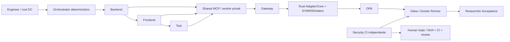

# Audit tecnico della pulizia PR #10

Audit del 15 ottobre 2026, riferito alla PR [#10](https://github.com/DarkGh0st03/delegation/pull/10), head `da769d09ad664b5cba215a07f54df0782c8297ab`, rispetto a `main` `33abe0e6b6ccbf13590f7c57f822b6338dafafbd`. Le correzioni sono preparate sul branch separato `audit/pr10-regression-guardrails`.

Il riferimento Gemini riuscito resta [run 38379922436](https://github.com/DarkGh0st03/delegation/actions/runs/38379922436), commit `9012c8c4e7a9244cb931bcdef411cc5f443f0c08`. API GitHub e documentazione conservata confermano SHA e conclusione `success`. Non è stata ripetuta inference Gemini/OpenAI, né avviato il workflow a pagamento o effettuato un merge. Nessuna modifica alla baseline remota `iam-console-poc`.

## Esito dell'audit senza modifiche

La PR conserva il runtime finale, ma la rimozione di vecchi job e script aveva eliminato controlli di sicurezza ancora significativi. Import risolti e CI verde non dimostravano da soli equivalenza della copertura. Il ripristino di `gemini-api-health-smoke.mjs` in `da769d09` è corretto: `adk-failure-categories.test.ts` lo importa per verificare classificazione e redazione degli errori senza chiamare il provider.

Sono stati esaminati ricorsivamente i 343 file tracciati della PR, 9 manifest npm, 4 lockfile verificati dal contratto attuale, 10 workflow, 23 Markdown inclusi tutti i 12 README, Rust/Adapter/Solidity/DID, entrypoint, test, risorse e script. Il grafo conservativo originale contiene 833 riferimenti; non risultano import relativi o risorse letterali mancanti. I 25 link Markdown locali originali hanno destinazioni esistenti. Sono stati verificati anche i consumer precedenti delle 62 eliminazioni della PR.

L'[inventario per file](audit/pr10-file-decisions.csv) riporta classificazione, decisione, motivo e prova. Copre tutte le 62 eliminazioni della PR e i candidati residui. Le classi sono: **necessario**, **obsoleto**, **storico ma ancora utilizzato**, **da verificare**. La sola assenza di un import non autorizza a cancellare un test indipendente, un API pubblico o un'utility di ricerca.

## Percorso finale e natura delle prove

L'E2E gratuito usa un `BaseLlm` scriptato e gli 11 file reference già fissati; ADK, A2A, MCP, deleghe, Gateway, OPA, Gitea e Runner sono reali. Il test positivo fa passare il candidato attraverso Runner e acceptance; un secondo executor indipendente pubblica lo stato Security CI sullo SHA esatto. L'assenza di review umana deve ancora impedire il merge. Non è una nuova prova di generazione Gemini né di approvazione umana autentica.

La verifica negativa dell'acceptance aggiunta usa una terza esecuzione Docker, su un branch temporaneo del baseline precedente alla funzionalità: le sei fasi del progetto devono passare, la suite indipendente deve eseguire vere asserzioni e fallire, e il verdetto complessivo deve essere `fail`. Un problema npm, browser mancante, timeout o fasi saltate non conta come controllo negativo riuscito.

## Correzioni della copertura

| Regressione | Recupero nella struttura corrente |
|---|---|
| Sei dinieghi reali eliminati con Phase 8C | `assert-current-authority-boundaries.mjs`, invocato dal solo E2E gratuito attuale |
| Acceptance negativa eliminata con Phase 6C | `assert-researcher-acceptance-negative.mjs`, executor reale e branch temporaneo al baseline esatto |
| Audit backend indipendente eliminato | Tre test in `runner/acceptance/backend-contract.spec.ts`, montati read-only insieme alla suite originale |
| Policy Gemini esclusa dalla CI | Tutti i 12 test `gemini-thinking-policy.test.mjs` reinseriti nel baseline offline |
| Bootstrap A2A non selezionato dalla CI | Suite `@thesis/a2a-agent` aggiunta al baseline, 9 test |
| Import di fixture eliminabili senza segnalazione | Guardia sintattica `check:imports` e 6 test, incluso il caso della fixture Gemini eliminata |
| Conflitti provider storici non riprovati | SHA blob obsoleto, file duplicato e PR duplicata recuperati nel medesimo helper attuale |
| Modifiche al Core non attivavano il Docker E2E | Filtri PR/push includono `src/**`, Cargo, blockchain, PoC e Adapter |
| Implementazione Rust parallela non selezionata | Baseline con `cargo test --locked --all-features` |

I sei casi di autorità sono Backend→Frontend, Backend→file security, Frontend→Backend, lettura→aggiornamento senza permesso, Test→sorgente applicativo e Test senza `run_tests`. Ogni caso prova sia il rifiuto della disclosure da parte dell'Adapter reale, sia il rifiuto Gateway di una VP autentica che contiene soltanto un altro permesso legittimo. Verifica SHA/contenuto Gitea invariati e nessun nuovo ingresso al Runner. OPA non viene dichiarata eseguita dopo una prova crittografica invalida: l'ordine fail-closed la esclude intenzionalmente.

Il controllo SHA obsoleto è dichiaratamente una richiesta diretta al provider Gitea: il tool Gateway non accetta uno SHA arbitrario dal chiamante e legge internamente quello corrente. Le due duplicazioni passano invece attraverso deleghe valide, Gateway e OPA e devono fallire con `409 provider_conflict`.

I nuovi test backend conservano enum ACTIVE/SUSPENDED, persistenza nel repository, email invariata, POST anonimo `401`, utente inesistente `404` e stato completo di `usr-002` invariato. La suite originale conserva transizioni, conflitti `409`, UI e doppio invio. Nessun test scritto dal candidato sostituisce questi controlli indipendenti.

Non è stato ripristinato alcun vecchio workflow. Le prove confluiscono nel baseline offline e nell'E2E Shared MCP già esistenti; il workflow manuale Gemini rimane invariato. L'output del nuovo E2E è conservato come artifact, mantenendo il codice d'uscita della pipeline.

## File eliminati, conservati e recuperati

### Eliminati in questa correzione

| File | Prova di inutilizzo |
|---|---|
| `poc/packages/agent-runtime/src/adk-backend-live-probe.ts` | Nessun export in `index.ts`, nessun effetto collaterale, unico importer superstite il proprio test. I consumer operativi Phase 10B e capture erano già eliminati nella PR #10. |
| `poc/packages/agent-runtime/test/adk-backend-live-probe.test.ts` | Tre test esclusivamente del vecchio helper; rimosso insieme al modulo, senza ridurre copertura del runtime finale. |

### Conservati intenzionalmente

- `gemini-api-health-smoke.mjs`, `gemini-model-metadata.mjs` e `gemini-backend-shape-smoke.mjs`: fixture/contratti offline ancora importati. Un CLI capace di chiamare un provider non implica che l'import di funzioni offline faccia inference.
- Manifest storico, sommario delle misurazioni, Phase 12A builder e checker Phase 12B: dipendenze transitive della riproducibilità. L'aggregatore Phase 12C resta disponibile per rianalisi storiche, pur senza caller automatico corrente.
- Evidenze della run Gemini riuscita e revisione degli 11 file: conservate byte per byte, senza attribuire i vecchi risultati al nuovo branch.
- OpenAI adapter, client e relativi test: il bootstrap A2A li seleziona ancora e il barrel li esporta. La loro rimozione richiede prima una migrazione esplicita dell'opzione/default e degli export; non sono file isolatamente inutilizzati. Il percorso finale Gemini sceglie esplicitamente il proprio modello.
- Mock e stub ancora usati da test, DID client invocato via subprocesso, `deploy-local.sh` richiamato dal bootstrap, API Rust pubblici e `parallel_verification`: necessari o da verificare prima di rimuoverli.
- `.gitkeep` ridondanti: innocui, non eliminati per produrre una pulizia numerica; i due sotto `infra/env` e `infra/gitea` sono richiesti dallo scaffold.

### Recuperati senza riesumare le vecchie fasi

Le asserzioni di `phase8c-authority-boundaries-smoke`, sentinel, `phase6c-acceptance-smoke`, conflitti Phase 5B e `backend-generated-audit.test.ts` sono migrate nei controlli sopra. I vecchi file rimangono rimossi dal working tree e consultabili nella storia. Le 15 vecchie guide eliminate non hanno riferimenti superstiti o loader generici; i README attuali e i runbook finali ne sostituiscono i percorsi attivi.

## Verifiche e limiti

Sulla PR originale `da769d09` erano già verificati quattro workflow PASS, compreso [Real Docker E2E gratuito 38727345789](https://github.com/DarkGh0st03/delegation/actions/runs/38727345789); il relativo step finale è effettivamente `success`. Quell'esito non viene riutilizzato come prova delle modifiche successive.

Verifiche locali sul branch di correzione:

| Verifica | Esito |
|---|---|
| Node: Gateway 56, Runner 20, agent-runtime 139, Orchestrator 55, MCP 17, A2A 9, script 25 | **321 PASS**, zero falliti/saltati/cancellati |
| Core Rust, tutte le feature | **64 PASS** |
| Adapter Rust, pacchetto separato | **12 PASS** |
| Solidity | **18 PASS** |
| OPA | **18 PASS** |
| Guardia import, scaffold, 11 file delegati | PASS; parsing di 194 file e 377 import relativi |
| Nuovi test backend sulla copia del baseline esatto | **2 FAIL attesi / 1 PASS**, senza errori di raccolta |
| Stessi test backend sulla copia con gli 11 file reference | **3 PASS** |

Le suite Node sono state eseguite senza chiavi provider e con un preload che blocca la rete esterna; nessun tentativo esterno registrato. Gli errori iniziali di provenienza dell'archivio senza `.git` erano stati diagnosticati e ripetuti con metadati autentici del commit; non sono errori del repository.

La prova Docker locale originale aveva raggiunto le 11 scritture reali, ma il download del browser era stato bloccato dalla rete cloud. Questo tentativo **non è un PASS E2E**; i fallimenti infrastrutturali non sono stati trasformati in successi. I nuovi assert integrati richiedono un'esecuzione completa dell'E2E corretto in CI o in un ambiente che consenta i download ufficiali. Gli esiti della nuova PR vanno verificati sul suo SHA, separatamente dalla run verde di `da769d09`.

La guardia import usa il parser Node senza linking/evaluation: controlla import/export runtime relativi statici, compresi i nuovi file non ignorati. Non pretende di verificare import dinamici, type-only eliminati, risorse runtime, API GitHub o tutti i comandi shell/YAML: restano oggetto dei test e del presente audit. Non introduce nuove dipendenze o modifiche ai lockfile.

## Questioni distinte ancora aperte

- Adapter Cargo separato senza lockfile tracciato: il lock radice non congela il suo intero grafo. Risolvere con revisione dedicata di lock/workspace, senza alterare gli hash storici.
- Tre dipendenze Rust dirette (`rand`, `csv`, `x25519-dalek`) e feature `efficient` risultano senza uso attivo. Il manifest rimane necessario: una pulizia delle dichiarazioni richiede aggiornamento esplicito del contratto corrente e validazione, non cancellazione del file.
- Il bootstrap OpenAI compatibile è ancora presente; una repository strettamente Gemini-only richiede una piccola migrazione separata, non cancellazioni di file esportati.
- Phase 11 resta automatico su `main` e manuale, non su PR. I controlli recuperati sono pre-merge nel workflow attuale; non equivalgono a dichiarare eseguito ogni esperimento storico di Phase 11.
- La protezione Gitea non richiede server-side il contesto Security CI; il verifier legge stato/approvazioni e il merge lega lo SHA. La race di un cambio stato CI sullo stesso SHA resta un limite preesistente, da rafforzare separatamente.
- Runner e acceptance mantengono il modello di isolamento del PoC: sorgenti acceptance read-only, ma toolchain e dipendenze del progetto vivono nello stesso container. Non è una prova di sandbox ostile completa. Nessuna verifica di review umana autentica o merge di produzione è stata eseguita.
- Rimane l'avviso di engine MikroORM (Node ≥22.17 contro pin 22.15). I controlli selezionati passano con il pin del riferimento; nessun aggiornamento implicito di runtime o lockfile.

Le correzioni dei README distinguono architettura attuale e checkpoint storici, coordinatore deterministico e ruoli ADK/Gemini, CI offline ed E2E, e inizializzazione locale conservativa senza rigenerare credenziali con `--force`.
